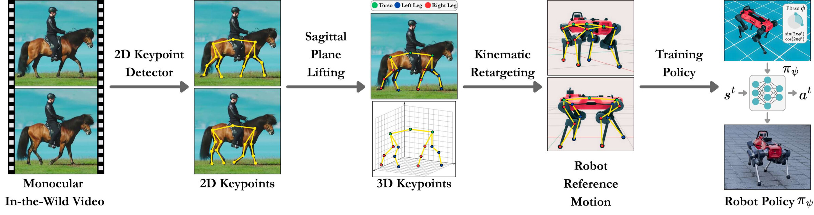
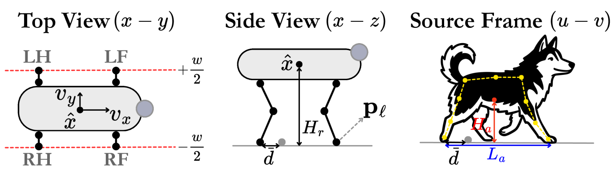
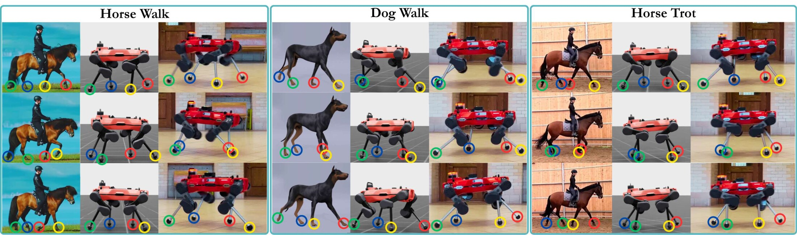
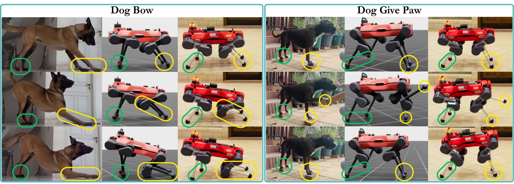
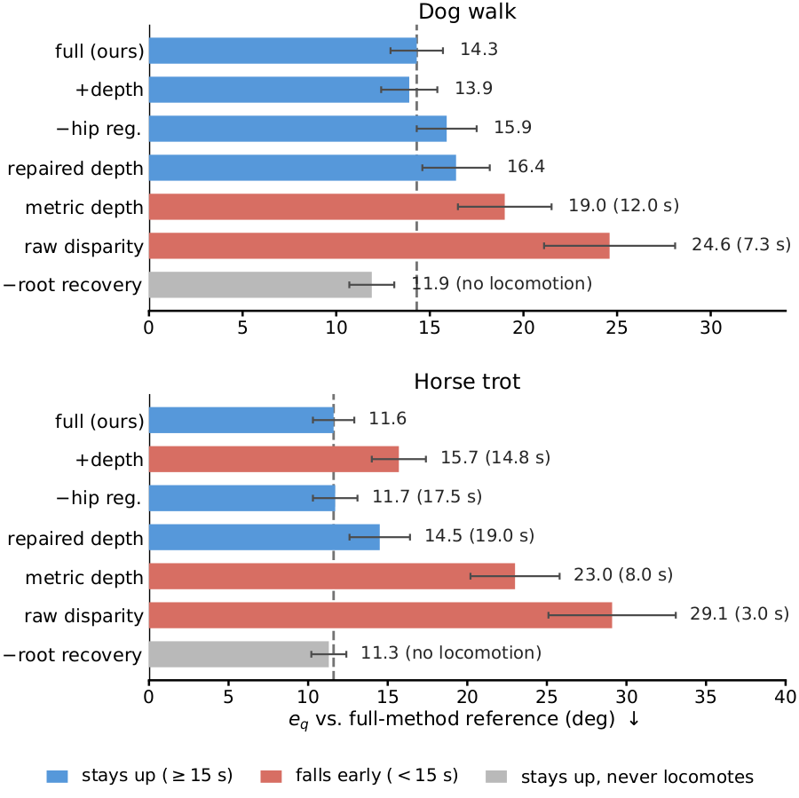

<style>
/* container: let this page breathe wider than the default column */
.main:has(.cq-root) { max-width: 1220px; }
.main:has(.cq-root) .post-header { margin-bottom: 0; }
.main:has(.cq-root) .post-title {
  text-align: center;
  font-size: clamp(1.4rem, 1rem + 1.8vw, 2rem);
  line-height: 1.26;
  letter-spacing: -0.015em;
  max-width: 920px;
  margin: 10px auto 4px;
  text-wrap: balance;
}

/* scoped design tokens */
.cq-root {
  --c-accent: #b8532e;          /* readable version of #e57048 on light bg */
  --c-gold: #e57048;            /* the chosen accent, for solid fills */
  --c-on-gold: #ffffff;
  --c-accent-bd: rgba(229, 112, 72, 0.42);
  --c-accent-soft: rgba(229, 112, 72, 0.10);
  --c-blue: #1583ad;
  --c-teal: #0e8f82;
  --c-purple: #9333b8;
  --c-radius: 14px;
  font-size: 16.5px;
  line-height: 1.68;
  color: var(--content);
}
.dark .cq-root {
  --c-accent: #ff9166;
  --c-gold: #e57048;
  --c-on-gold: #2b1208;
  --c-accent-bd: rgba(229, 112, 72, 0.38);
  --c-accent-soft: rgba(229, 112, 72, 0.14);
  --c-blue: #54c1e8;
  --c-teal: #39c2b2;
  --c-purple: #d183ee;
}

.cq-root .cq-prose > p,
.cq-root .cq-abstract-body,
.cq-root .cq-tldr p,
.cq-root .cq-punch,
.cq-root .cq-card p,
.cq-root .cq-callout {
  text-align: justify;
  text-justify: inter-word;
}
.cq-root b, .cq-root strong { color: var(--primary); font-weight: 700; }

/* hero */
.cq-hero { text-align: center; max-width: 860px; margin: 0.6rem auto 2.2rem; }
.cq-venue {
  display: inline-block; margin-bottom: 1rem;
  padding: 0.4rem 1.05rem; border-radius: 999px;
  font-size: 0.8rem; font-weight: 700; letter-spacing: 0.03em;
  color: var(--c-accent);
  background: var(--c-accent-soft);
  border: 1px solid var(--c-accent-bd);
}
.cq-authors { font-size: 1.02rem; line-height: 1.95; margin: 0 0 0.9rem; }
.cq-authors sup { color: var(--c-accent); font-weight: 700; font-size: 0.62em; margin-left: 1px; }
.cq-affils {
  display: flex; flex-wrap: wrap; gap: 0.5rem;
  justify-content: center; align-items: center; margin: 0;
}
.cq-affils .logo {
  display: flex; align-items: center; justify-content: center;
  height: 40px; padding: 0 0.85rem; box-sizing: border-box;
  background: #fff; border-radius: 9px;
  border: 1px solid rgba(0, 0, 0, 0.07);
  box-shadow: 0 1px 3px rgba(0, 0, 0, 0.14);
}
.cq-affils .logo img { height: 19px; width: auto; max-width: 132px; display: block; margin: 0; align-self: center; }
@media (max-width: 460px) {
  .cq-affils .logo { height: 33px; padding: 0 0.65rem; }
  .cq-affils .logo img { height: 15px; max-width: 104px; }
}

.cq-btns { display: flex; flex-wrap: wrap; gap: 0.55rem; justify-content: center; margin-top: 1.5rem; }
.cq-root a.cq-btn {
  display: inline-flex; align-items: center; gap: 0.45rem;
  padding: 0.5rem 1.05rem; border-radius: 999px;
  border: 1px solid var(--border); background: var(--entry);
  color: var(--primary) !important; box-shadow: none !important;
  font-size: 0.88rem; font-weight: 600; text-decoration: none !important;
  transition: transform 0.13s ease, border-color 0.13s ease, background 0.13s ease;
}
.cq-root a.cq-btn:hover { transform: translateY(-2px); border-color: var(--c-accent); }
.cq-root a.cq-btn svg { width: 15px; height: 15px; flex-shrink: 0; }
.cq-root a.cq-btn--primary { background: var(--c-gold); border-color: var(--c-gold); color: var(--c-on-gold) !important; }
.cq-root a.cq-btn--primary:hover { filter: brightness(1.08); border-color: var(--c-gold); }

/* section headings */
.cq-root .cq-h2 {
  font-size: 1.34rem; font-weight: 750; letter-spacing: -0.01em;
  margin: 3rem 0 1rem; padding-bottom: 0.4rem;
  border-bottom: 1px solid var(--border); color: var(--primary);
  text-wrap: balance;
}
.cq-root .cq-h2::before {
  content: ""; display: inline-block; width: 0.6rem; height: 0.6rem;
  border-radius: 3px; background: var(--c-accent);
  margin-right: 0.6rem; transform: translateY(-2px);
}
.cq-root .cq-h3 { font-size: 1.06rem; font-weight: 700; margin: 2rem 0 0.6rem; color: var(--primary); text-wrap: balance; }

/* figures */
.cq-root .cq-fig { margin: 1.7rem auto 1.9rem; }
.cq-root .cq-fig figure { margin: 0; }
.cq-root .cq-fig a { box-shadow: none !important; display: block; }
.cq-root .cq-fig img {
  display: block; width: 100%; height: auto; margin: 0;
  border-radius: var(--c-radius); background: #fff;
  border: 1px solid var(--border);
  box-shadow: 0 1px 3px rgba(0,0,0,0.05), 0 12px 32px -16px rgba(0,0,0,0.25);
}
.cq-root .cq-fig--pad img { padding: 16px; }
.cq-root .cq-fig--sm { max-width: 60%; margin-left: auto; margin-right: auto; }
@media (max-width: 640px) { .cq-root .cq-fig--sm { max-width: 100%; } }
.cq-root .cq-fig--70 { max-width: 52%; margin-left: auto; margin-right: auto; }
@media (max-width: 640px) { .cq-root .cq-fig--70 { max-width: 100%; } }
.cq-root .cq-fig figcaption {
  margin: 0.75rem 0 0;
  font-size: 0.82rem; font-weight: 400; line-height: 1.55;
  color: var(--secondary); text-align: justify; text-justify: inter-word;
}
.cq-root .cq-fig figcaption b { color: var(--primary); }

/* TL;DR panel */
.cq-tldr {
  margin: 1.8rem 0 2.2rem; padding: 1.4rem 1.5rem;
  border-radius: var(--c-radius);
  background: var(--c-accent-soft); border: 1px solid var(--c-accent-bd);
}
.cq-tldr p { margin: 0; font-size: 1rem; line-height: 1.62; }
.cq-stats {
  display: grid; grid-template-columns: repeat(4, 1fr); gap: 1rem;
  margin-top: 1.3rem; padding-top: 1.2rem;
  border-top: 1px solid var(--c-accent-bd);
}
.cq-stat { text-align: center; }
.cq-stat b { display: block; font-size: 1.4rem; font-weight: 800; color: var(--c-accent); line-height: 1.1; letter-spacing: -0.02em; }
.cq-stat span { display: block; margin-top: 0.35rem; font-size: 0.75rem; color: var(--secondary); line-height: 1.4; }
@media (max-width: 620px) { .cq-stats { grid-template-columns: repeat(2, 1fr); } }

/* component cards */
.cq-cards { display: grid; grid-template-columns: repeat(3, 1fr); gap: 1rem; margin: 1.6rem 0; }
@media (max-width: 820px) { .cq-cards { grid-template-columns: 1fr; } }
.cq-card {
  position: relative; overflow: hidden;
  border: 1px solid var(--border); border-radius: var(--c-radius);
  padding: 1.2rem 1.2rem 1.25rem; background: var(--entry);
}
.cq-card::before { content: ""; position: absolute; inset: 0 0 auto 0; height: 3px; background: var(--c); }
.cq-card .ic {
  width: 34px; height: 34px; border-radius: 9px; display: grid; place-items: center;
  background: var(--cs); color: var(--c); margin-bottom: 0.75rem;
}
.cq-card .ic svg { width: 19px; height: 19px; }
.cq-card h4 { margin: 0; font-size: 0.99rem; font-weight: 700; color: var(--primary); text-transform: none; }
.cq-card .abbr {
  display: block; margin: 0.35rem 0 0.65rem; font-size: 0.92rem; font-weight: 600;
  font-family: ui-monospace, SFMono-Regular, Menlo, monospace; color: var(--c);
  line-height: 1.4; overflow-wrap: break-word;
}
.cq-card p { margin: 0; font-size: 0.845rem; color: var(--secondary); line-height: 1.62; }

/* callout */
.cq-callout {
  margin: 1.7rem 0; padding: 1.15rem 1.35rem;
  border-left: 3px solid var(--c-teal); background: rgba(14, 143, 130, 0.08);
  border-radius: 0 var(--c-radius) var(--c-radius) 0; font-size: 0.9rem; line-height: 1.62;
}
.dark .cq-callout { background: rgba(57, 194, 178, 0.1); }
.cq-callout b { color: var(--primary); }

/* video */
.cq-video { margin: 1.5rem auto; }
.cq-video video {
  display: block; width: 100%; height: auto;
  border-radius: var(--c-radius); border: 1px solid var(--border); background: #0d0d0d;
}
.cq-video figcaption { margin: 0.6rem 0 0; font-size: 0.8rem; color: var(--secondary); text-align: justify; text-justify: inter-word; }

/* tables */
.cq-root .cq-tw {
  display: block; width: 100%; overflow-x: auto; margin: 1.4rem 0;
  border: 1px solid var(--border); border-radius: var(--c-radius);
}
.cq-root .cq-t {
  display: table; width: 100%; min-width: 620px;
  table-layout: auto; border-collapse: collapse; border-spacing: 0;
  font-size: 0.83rem; margin: 0;
}
.cq-root .cq-t th, .cq-root .cq-t td {
  padding: 0.5rem 0.75rem; text-align: center; border: 0;
  border-bottom: 1px solid var(--border);
}
.cq-root .cq-t thead th { background: var(--entry); font-weight: 700; color: var(--primary); }
.cq-root .cq-t thead tr:last-child th { font-size: 0.74rem; color: var(--secondary); font-weight: 600; }
.cq-root .cq-t td:first-child, .cq-root .cq-t th:first-child { text-align: left; }
.cq-root .cq-t tbody tr:last-child td { border-bottom: 0; }
.cq-root .cq-t .row-hl td { background: var(--c-accent-soft); }
.cq-root .cq-t .row-hl td:first-child { color: var(--c-accent); font-weight: 700; }
.cq-root .cq-t .sep td { border-bottom: 2px solid var(--tertiary); }

/* details */
.cq-root .cq-details {
  margin: 1.4rem 0; border: 1px solid var(--border);
  border-radius: var(--c-radius); background: var(--entry); overflow: hidden;
}
.cq-root .cq-details > summary {
  cursor: pointer; padding: 0.85rem 1.1rem; font-size: 0.9rem; font-weight: 600;
  color: var(--primary); list-style: none;
}
.cq-root .cq-details > summary::-webkit-details-marker { display: none; }
.cq-root .cq-details > summary::before { content: "▸ "; color: var(--c-accent); }
.cq-root .cq-details[open] > summary::before { content: "▾ "; }
.cq-root .cq-details .cq-fig, .cq-root .cq-details .cq-tw { margin: 0.2rem 1.1rem 1.1rem; }
.cq-root .cq-details--abstract { margin: 1.8rem 0; }
.cq-root .cq-details--abstract > summary { font-size: 1.05rem; font-weight: 700; padding: 1rem 1.2rem; }
.cq-root .cq-details--abstract .cq-abstract-body {
  padding: 0.2rem 1.2rem 1.2rem; font-size: 0.95rem; line-height: 1.7; color: var(--content);
}
.cq-root .cq-details--abstract .cq-abstract-body b { color: var(--primary); }

/* footer links */
.cq-foot {
  margin-top: 2.5rem; padding-top: 1.4rem; border-top: 1px solid var(--border);
  text-align: center; font-size: 0.86rem; color: var(--secondary);
}
.cq-root .cq-foot a { color: var(--c-accent); }
</style>

<div class="cq-root">

<div class="cq-hero">
  <div class="cq-venue">Preprint&nbsp;·&nbsp;under review</div>
  <div class="cq-authors">
    Mohamad&nbsp;H.&nbsp;Danesh<sup>1,2</sup>&nbsp;&nbsp; Raina&nbsp;Hu<sup>1</sup>&nbsp;&nbsp; Mengxue&nbsp;Xu<sup>1</sup>&nbsp;&nbsp; Hsiu-Chin&nbsp;Lin<sup>1,2</sup>
  </div>
  <div class="cq-affils">
    <span class="logo"></span>
    <span class="logo"></span>
  </div>
  <div class="cq-btns">
    <a class="cq-btn cq-btn--primary" href="copyquad.pdf" target="_blank" rel="noopener">
      <svg viewBox="0 0 24 24" fill="none" stroke="currentColor" stroke-width="2" stroke-linecap="round" stroke-linejoin="round"><path d="M21 15v4a2 2 0 0 1-2 2H5a2 2 0 0 1-2-2v-4"/><polyline points="7 10 12 15 17 10"/><line x1="12" y1="15" x2="12" y2="3"/></svg>
      PDF
    </a>
    <a class="cq-btn" href="#bibtex">
      <svg viewBox="0 0 24 24" fill="none" stroke="currentColor" stroke-width="2" stroke-linecap="round" stroke-linejoin="round"><path d="M3 21c3 0 7-1 7-8V5a2 2 0 0 0-2-2H4a2 2 0 0 0-2 2v6a2 2 0 0 0 2 2h4"/><path d="M14 21c3 0 7-1 7-8V5a2 2 0 0 0-2-2h-4a2 2 0 0 0-2 2v6a2 2 0 0 0 2 2h4"/></svg>
      BibTeX
    </a>
  </div>
</div>

<figure class="cq-video" style="max-width:80%;">
  <video autoplay muted loop playsinline controls preload="auto" poster="project_assets/demo-poster.jpg">
    <source src="project_assets/demo.mp4" type="video/mp4">
  </video>
</figure>

<details class="cq-details cq-details--abstract">
<summary>Abstract</summary>
<div class="cq-abstract-body">
Video-to-robot pipelines for quadrupedal imitation insert a learned lifting stage, either a monocular depth model or a per-clip 3D reconstruction, to recover the one axis a side-view camera cannot see. We present <b>CopyQuad</b>, which omits that stage and pins the missing axis to the robot's own stance width instead. The setting is side-view footage of sagittally dominated motion, where limb motion is almost entirely in the image plane. A frozen 2D keypoint detector and a fixed analytic retargeting then turn a single uncalibrated clip into a robot reference whose foot targets are reachable by construction, so no per-clip trajectory optimization is needed. One phase-indexed reward structure, whose only per-behavior freedom is three scalars from a shared sweep, learns a dog walk, a horse walk, a horse trot and two non-periodic gestures, all deployed zero-shot on hardware. We then measure what omitting the axis costs. In a training-free rigidity test, a video depth model varies the distance between the animal's hips by 40 to 107% of its own mean and a single-image metric model by 22 to 58%, though that distance cannot move. Motion capture puts the true lateral paw travel of a dog walk at 4.5 cm peak to peak, a mean deviation near 1.4 cm against the 3.5 cm of lateral foot error our policies already leave, so the discarded axis sits below the pipeline's resolution. Depth repaired to feasibility never beats the constant, and the unrepaired estimates put the robot on the ground.
</div>
</details>

<div class="cq-tldr">
  <p><b>CopyQuad skips the hardest step in video-to-robot imitation: estimating depth.</b> A side-view camera of a walking or trotting animal already shows almost everything a robot's retargeter needs, fore-aft motion and height. It hides only the sideways axis across the body, the one a depth model is normally called in to recover. CopyQuad doesn't recover it. It pins that axis to the robot's own stance width and measures what that costs, instead of assuming a depth model would do better.</p>
  <div class="cq-stats">
    <div class="cq-stat"><b>5</b><span>animal behaviors, one clip each</span></div>
    <div class="cq-stat"><b>no depth model</b><span>the missing axis is pinned, not estimated</span></div>
    <div class="cq-stat"><b>2 species</b><span>dog and horse, one shared pipeline</span></div>
    <div class="cq-stat"><b>zero-shot</b><span>sim to hardware, no fine-tuning</span></div>
  </div>
</div>

<h2 class="cq-h2">How CopyQuad works</h2>

<div class="cq-prose">
<p>A side-view camera is a weak-perspective projection of the sagittal plane: it reads fore-aft position and height cleanly, and hides the lateral axis across the animal's body almost entirely. Prior pipelines add a lifting stage, a monocular depth model or a per-clip 3D reconstruction, to recover that missing axis. CopyQuad skips it. A quadruped's lateral limb motion is small to begin with, so CopyQuad just pins that coordinate to the robot's own stance width and lets a fixed analytic pipeline do the rest.</p>
</div>

<figure class="cq-fig cq-fig--pad">
  <a href="project_assets/overview.jpg" target="_blank" rel="noopener"></a>
  <figcaption>A frozen 2D keypoint detector reads the animal's pose from the video. Sagittal-plane lifting pins the hidden lateral axis to the robot's stance width. Kinematic retargeting turns that into a robot-reachable reference, and a phase-indexed policy is trained in simulation to track it.</figcaption>
</figure>

<div class="cq-cards">
  <div class="cq-card" style="--c: var(--c-teal); --cs: rgba(14,143,130,0.10);">
    <div class="ic"><svg viewBox="0 0 24 24" fill="none" stroke="currentColor" stroke-width="2" stroke-linecap="round" stroke-linejoin="round"><circle cx="12" cy="12" r="3"/><path d="M12 2v4M12 18v4M4.9 4.9l2.8 2.8M16.3 16.3l2.8 2.8M2 12h4M18 12h4M4.9 19.1l2.8-2.8M16.3 7.7l2.8-2.8"/></svg></div>
    <h4>Sagittal lifting, pinned laterally</h4>
    <span class="abbr">pₖ = (sₓuₖ, y_nom, −s_z vₖ)</span>
    <p>Each 2D keypoint gives fore-aft and vertical pixel position. The lateral coordinate is set to a fixed value read off the robot's own morphology, &plusmn;half its stance width, rather than estimated. Every foot target then lies on a track the robot can already reach, on every clip, with no per-clip repair.</p>
  </div>
  <div class="cq-card" style="--c: var(--c-blue); --cs: rgba(21,131,173,0.10);">
    <div class="ic"><svg viewBox="0 0 24 24" fill="none" stroke="currentColor" stroke-width="2" stroke-linecap="round" stroke-linejoin="round"><path d="M4 4v16h16"/><path d="M4 15l4-4 3 3 6-7"/></svg></div>
    <h4>Kinematic retargeting &amp; root recovery</h4>
    <span class="abbr">v̂ = d̄ &times; f̂</span>
    <p>Damped least-squares IK turns the lifted keypoints into joint angles, holding the base fixed. Forward translation isn't captured by IK alone, so it's recovered separately from each foot's fore-aft sweep and the gait's footfall frequency, giving a straight-line base trajectory the policy can track.</p>
  </div>
  <div class="cq-card" style="--c: var(--c-purple); --cs: rgba(147,51,184,0.10);">
    <div class="ic"><svg viewBox="0 0 24 24" fill="none" stroke="currentColor" stroke-width="2" stroke-linecap="round" stroke-linejoin="round"><path d="M3 3v18h18"/><path d="M7 14l3-3 3 3 5-6"/><circle cx="7" cy="14" r="1"/><circle cx="18" cy="8" r="1"/></svg></div>
    <h4>Phase-indexed imitation policy</h4>
    <span class="abbr">rₜ = wⱼrⱼ + w_f r_f + wᵣrᵣ − wₐrₐ</span>
    <p>One DeepMimic-style policy per behavior tracks the reference at its current phase, rewarded for matching joint angles, foot positions and root motion while penalizing jerky actions. The only thing that changes between behaviors is three reward scalars, picked from one shared grid.</p>
  </div>
</div>

<figure class="cq-fig cq-fig--pad cq-fig--sm">
  <a href="project_assets/robot_frame.png" target="_blank" rel="noopener"></a>
  <figcaption>The reference quantities. Left: the stance tracks the lateral axis is pinned to. Middle: robot height and the foot sweep used for root recovery. Right: the detector keypoints read directly from pixels, and the spans matched between the animal and the robot to scale everything to the right size.</figcaption>
</figure>

<div class="cq-callout">
  <b>Nothing in the video-to-reference chain is trained or fit per clip.</b> The 2D keypoint detector runs frozen and zero-shot, the lifting and retargeting are fixed analytic rules applied identically to every clip, and the only learned component is the control policy itself, trained entirely in simulation. Of 24 candidate internet clips screened against four simple assumptions (a roughly static camera, travel roughly perpendicular to it, steady depth, and steady-state motion), 14 passed, close to three in five with no curation beyond the screen itself.
</div>

<h2 class="cq-h2">Results</h2>

<h3 class="cq-h3">Five behaviors, in simulation and on hardware</h3>

<div class="cq-prose">
<p>Using one pipeline and one reward structure, CopyQuad learns a dog walk, a horse walk, a horse trot, a dog bow and a dog give-paw, each from a single clip, and transfers every one of them to a physical ANYmal-D zero-shot. Agreement with the reference is coarse by design: the per-joint error concentrates in the sagittal hip and knee, the joints actually driven from the image, and not in the pinned hip abduction. The claim is gait-structure transfer, not pose-level fidelity, and the keyframes below show that structure surviving the jump from video to simulation to hardware intact.</p>
</div>

<div class="cq-tw">
<table class="cq-t">
  <thead>
    <tr><th rowspan="2">Behavior</th><th>Dog walk</th><th>Horse walk</th><th>Horse trot</th><th>Dog bow</th><th>Dog give-paw</th></tr>
    <tr><th colspan="5" style="font-weight:400;">clip fps / length (s)</th></tr>
  </thead>
  <tbody>
    <tr><td>Source clip</td><td>30 / 21.4</td><td>25 / 21</td><td>30 / 36</td><td>50 / 7</td><td>30 / 8</td></tr>
    <tr class="sep"><td>Sim: ep (cm) &darr;</td><td>13.7&plusmn;1.8</td><td>15.0&plusmn;2.6</td><td>15.5&plusmn;2.0</td><td>7.4&plusmn;0.4</td><td>11.8&plusmn;6.8</td></tr>
    <tr><td>Sim: survival (s, cap 20)</td><td>19.9&plusmn;0.2</td><td>19.5&plusmn;0.7</td><td>19.6&plusmn;0.5</td><td>20.0&plusmn;0.0</td><td>15.1&plusmn;2.9</td></tr>
    <tr class="row-hl sep"><td>Hardware: eq (deg) &darr;</td><td>16.8&plusmn;1.1</td><td>15.4&plusmn;1.3</td><td>13.5&plusmn;1.0</td><td>5.9&plusmn;0.5</td><td>9.6&plusmn;2.8</td></tr>
    <tr class="row-hl"><td>Hardware: ep (cm) &darr;</td><td>15.9&plusmn;1.4</td><td>17.1&plusmn;1.7</td><td>17.8&plusmn;1.5</td><td>8.6&plusmn;0.6</td><td>13.1&plusmn;3.9</td></tr>
    <tr class="row-hl"><td>Hardware: survival (s, cap 20)</td><td>20.0&plusmn;0.0</td><td>20.0&plusmn;0.0</td><td>20.0&plusmn;0.0</td><td>20.0&plusmn;0.0</td><td>19.0&plusmn;2.0</td></tr>
  </tbody>
</table>
</div>

<div class="cq-prose">
<p>A do-nothing floor, holding the nominal stance for the whole episode, reaches 28&ndash;30&deg; of joint error on the three gaits, roughly double what CopyQuad leaves. The gestures are the clearest evidence that posture comes entirely from tracking the legs: base orientation is never commanded, yet the bow's stand-bow-stand cycle and the give-paw's three-legged balance are both recognizable on hardware. Every behavior is deployed to the physical robot zero-shot, with no fine-tuning, real-world data or gain retuning.</p>
</div>

<figure class="cq-fig">
  <a href="project_assets/keyframes_1.jpg" target="_blank" rel="noopener"></a>
  <figcaption>Source video, simulated policy and hardware rollout at three matched phases, for the horse walk, dog walk and horse trot. Read left to right, each triplet reaches the same point in the gait cycle, with the trot's diagonal legs swinging and landing together while the walks move one leg at a time.</figcaption>
</figure>

<figure class="cq-fig">
  <a href="project_assets/keyframes_2.jpg" target="_blank" rel="noopener"></a>
  <figcaption>The same comparison for the two non-periodic gestures. Both are recognizable from posture alone, on hardware as well as in simulation, even though nothing in the reward commands the robot's orientation.</figcaption>
</figure>

<h3 class="cq-h3">Is the missing axis worth recovering?</h3>

<div class="cq-prose">
<p>CopyQuad pins the lateral axis instead of estimating it, so the natural question is whether a depth model would do better. Swapping the pin for three levels of depth, raw disparity, metric depth, and metric depth repaired to feasibility, answers it: raw disparity puts the robot on the ground within seconds, metric depth survives longer but still falls, and even repaired depth, the closest analogue to what per-clip optimization buys in prior work, never beats the constant pin.</p>
</div>

<figure class="cq-fig cq-fig--pad cq-fig--70">
  <a href="project_assets/ablation_bars.png" target="_blank" rel="noopener"></a>
  <figcaption>Retargeting ablation on the dog walk and horse trot. Every variant is evaluated against the full method's own reference. Blue stays up and locomotes, red falls early, gray stays up but never travels. Three stages of depth machinery end up behind a single number read off the robot's own body.</figcaption>
</figure>

<details class="cq-details">
  <summary>The rigidity test: can a depth model even hold a constant distance?</summary>
  <div class="cq-prose" style="padding:0.2rem 1.1rem 1.1rem;">
  <p>The left-right hip separation a depth model implies is a rigid distance that cannot move, so a faithful model should return it as nearly constant, with no training or ground truth required to check. Neither of two recent, widely used models does. A relative video depth model (VDA) varies the implied separation by 40&ndash;107% of its own mean on the dog clips, and returns almost no separation at all on the horse clips. A single-image metric model (Depth Pro) roughly halves that swing, but still varies by tens of percent, and on the trot it puts the left and right hip on the wrong side of each other in two frames out of five, barely above what a coin flip would give. On the dog walk that is about 2 cm of frame-to-frame drift on a quantity that cannot move, set against the 4.5 cm peak-to-peak of true paw travel the motion itself contains.</p>
  </div>
</details>

<h3 class="cq-h3">What video costs against motion capture</h3>

<div class="cq-prose">
<p>Motion capture gives the one setting where the discarded axis can be checked against ground truth. Two routes run on the same underlying dog-walk motion: one retargets the 3D markers directly, the other renders that motion to video and recovers a reference with CopyQuad alone, discarding the 3D entirely. Both share the same retargeter, reward and training budget.</p>
</div>

<div class="cq-tw">
<table class="cq-t">
  <thead>
    <tr><th>Route</th><th>eq (deg) &darr;</th><th>ep (cm) &darr;</th><th>Survival (s, cap 20)</th></tr>
  </thead>
  <tbody>
    <tr><td>MoCap route</td><td>9.5&plusmn;1.0</td><td>10.5&plusmn;1.5</td><td>20.0</td></tr>
    <tr class="row-hl"><td>Video route (CopyQuad)</td><td>12.5&plusmn;1.4</td><td>13.5&plusmn;1.8</td><td>20.0</td></tr>
  </tbody>
</table>
</div>

<div class="cq-prose">
<p>The two routes differ by 3.0&deg; and 3.0 cm, and both survive the full episode. That gap is the price of video at this tracking bandwidth, measured on a rendered clip with no blur, occlusion or compression, so it's a lower bound on the cost of real footage. The number that settles whether the gap matters is simpler: the true peak-to-peak lateral paw excursion of this walk is 4.5 cm, with a mean deviation near 1.4 cm, against the 3.5 cm of lateral foot error the policies already leave. Perfect lateral tracking would remove at most 1.4 of those 3.5 cm, under a tenth of the total foot error, so the discarded axis sits below the pipeline's own resolution.</p>
</div>

<h2 class="cq-h2">Limitations</h2>

<div class="cq-prose">
<p>The design is scoped to sagittally dominated motion under a roughly static camera, conditions two in five casually chosen clips fail to meet. It's bounded to symmetric gaits: a canter's lateral excursion is comparable to the lateral foot error itself, which is well outside the regime the pin is built for. And the rigidity argument covers per-pixel monocular depth specifically, not per-clip articulated 3D reconstruction, which does hold the rigid axis, just at the cost of a per-clip optimization that this pipeline is built to avoid.</p>
</div>

<h2 class="cq-h2" id="bibtex">BibTeX</h2>

</div>

```bibtex
@misc{danesh2026copyquad,
  title  = {CopyQuad: Quadrupedal Skill Transfer from a Single Side-View
            Video Without a Depth Model},
  author = {Danesh, Mohamad H. and Hu, Raina and Xu, Mengxue and Lin, Hsiu-Chin},
  year   = {2026},
  note   = {Preprint, under review}
}
```

<div class="cq-root">
<div class="cq-foot">
  <a href="copyquad.pdf">PDF</a>
</div>
</div>
