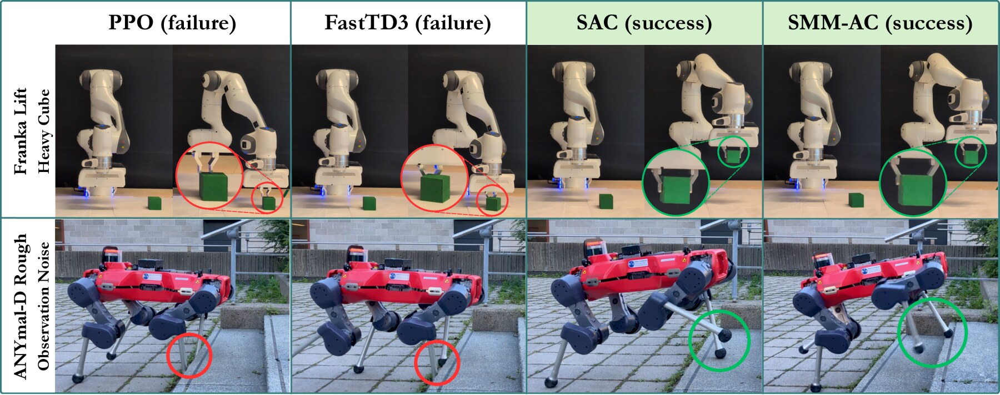
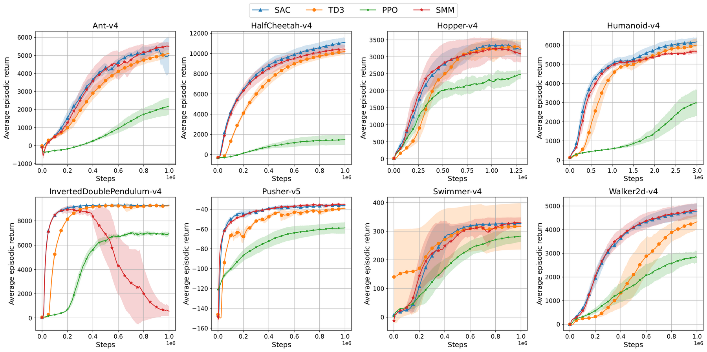
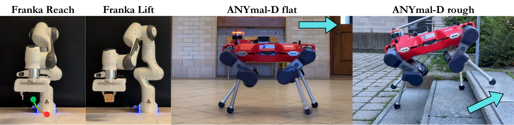
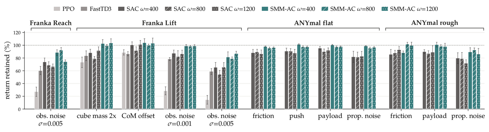

<style>
/* a narrow, serif, journal-style column — deliberately not the wide card-dashboard
   layout used on the other paper pages */
.main:has(.smm-root) { max-width: 820px; }
.main:has(.smm-root) .post-header { margin-bottom: 0; text-align: center !important; }
.main:has(.smm-root) .post-title {
  text-align: center !important;
  width: 100%;
  font-family: Georgia, 'Iowan Old Style', 'Palatino Linotype', 'Book Antiqua', 'Times New Roman', serif;
  font-weight: 700;
  font-size: clamp(1.5rem, 1.05rem + 1.9vw, 2.15rem);
  line-height: 1.28;
  letter-spacing: -0.01em;
  max-width: 700px;
  margin: 6px auto 0 !important;
  text-wrap: balance;
}

.smm-root {
  --c-accent: #0b6d63;
  --c-accent-bd: rgba(18, 137, 122, 0.4);
  --serif: Georgia, 'Iowan Old Style', 'Palatino Linotype', 'Book Antiqua', 'Times New Roman', serif;
  font-family: var(--serif);
  font-size: 16.5px;
  line-height: 1.72;
  color: var(--content);
}
.dark .smm-root { --c-accent: #52d9c4; --c-accent-bd: rgba(82, 217, 196, 0.4); }
.smm-root b, .smm-root strong { color: var(--primary); font-weight: 700; }
.smm-root .smm-measure { max-width: 700px; margin: 0 auto; }

/* masthead */
.smm-kicker {
  text-align: center; margin: 0.3rem 0 1.1rem;
  font-family: ui-sans-serif, system-ui, sans-serif;
  font-size: 0.74rem; font-weight: 700; letter-spacing: 0.16em; text-transform: uppercase;
  color: var(--c-accent);
}
.smm-byline { text-align: center; font-size: 1.01rem; margin: 0 0 0.3rem; }
.smm-byline sup { font-family: ui-sans-serif, system-ui, sans-serif; color: var(--c-accent); font-weight: 700; font-size: 0.6em; }
.smm-affilkey {
  text-align: center; font-family: ui-sans-serif, system-ui, sans-serif;
  font-size: 0.76rem; color: var(--secondary); margin: 0 0 1.3rem;
}
.smm-logos { display: flex; justify-content: center; align-items: center; gap: 0.6rem; flex-wrap: wrap; margin: 0 0 1.4rem; }
.smm-logos .chip {
  display: flex; align-items: center; justify-content: center;
  height: 38px; padding: 0 0.8rem; box-sizing: border-box;
  background: #fff; border-radius: 8px;
  border: 1px solid rgba(0, 0, 0, 0.08);
}
.smm-logos img { height: 19px; width: auto; max-width: 118px; display: block; margin: 0; }
.smm-actions {
  text-align: center; font-family: ui-sans-serif, system-ui, sans-serif;
  font-size: 0.86rem; font-weight: 600; letter-spacing: 0.02em;
  margin: 0 0 1.6rem;
}
.smm-root .smm-actions a { color: var(--c-accent) !important; box-shadow: none !important; text-decoration: none; }
.smm-root .smm-actions a:hover { text-decoration: underline; }
.smm-actions .sep { color: var(--secondary); margin: 0 0.65rem; }
.smm-hr { border: 0; border-top: 1px solid var(--border); margin: 0 0 2.1rem; }

/* figures: plain, rule-framed, no card shadows */
.smm-root .smm-fig { margin: 2.1rem 0; }
.smm-root .smm-fig figure { margin: 0; }
.smm-root .smm-fig a { box-shadow: none !important; display: block; }
.smm-root .smm-fig img {
  display: block; width: 100%; height: auto; margin: 0;
  border-top: 1px solid var(--border); border-bottom: 1px solid var(--border);
  background: #fff;
}
.smm-root .smm-fig--pad img { padding: 18px; }
.smm-root .smm-fig figcaption {
  margin: 0.7rem 0 0; font-family: ui-sans-serif, system-ui, sans-serif;
  font-size: 0.82rem; line-height: 1.6; color: var(--secondary);
}
.smm-root .smm-fig figcaption .lbl {
  font-weight: 700; color: var(--primary); font-variant: small-caps; letter-spacing: 0.02em;
}

/* abstract */
.smm-abstract { margin: 0 0 2.2rem; padding-left: 1.1rem; border-left: 2px solid var(--c-accent-bd); }
.smm-abstract .lbl {
  display: block; font-family: ui-sans-serif, system-ui, sans-serif;
  font-size: 0.72rem; font-weight: 700; letter-spacing: 0.14em; text-transform: uppercase;
  color: var(--c-accent); margin-bottom: 0.55rem;
}
.smm-abstract p { margin: 0; font-style: italic; }

/* highlights list, replaces the old stat-grid panel */
.smm-highlights { margin: 0 0 2.4rem; padding: 0; list-style: none; }
.smm-highlights li {
  position: relative; padding-left: 1.3rem; margin: 0.55rem 0;
}
.smm-highlights li::before {
  content: "—"; position: absolute; left: 0; color: var(--c-accent); font-weight: 700;
}

/* numbered sections */
.smm-root .smm-h2 {
  display: flex; align-items: baseline; gap: 0.6rem;
  font-size: 1.22rem; font-weight: 700; letter-spacing: -0.005em;
  margin: 3rem 0 1.1rem; padding-bottom: 0.5rem;
  border-bottom: 1px solid var(--border); color: var(--primary);
}
.smm-root .smm-h2 .num {
  font-size: 0.95em; color: var(--c-accent); font-weight: 700;
}
.smm-root .smm-h3 { font-size: 1.02rem; font-weight: 700; font-style: italic; margin: 1.9rem 0 0.6rem; color: var(--primary); }

/* numbered method steps, replaces the old 3-card grid */
.smm-steps { margin: 1.7rem 0; }
.smm-step { display: flex; gap: 1.1rem; padding: 1.3rem 0; border-top: 1px solid var(--border); }
.smm-step:last-child { border-bottom: 1px solid var(--border); }
.smm-step .n {
  flex: 0 0 auto; width: 2.3rem; font-size: 1.5rem; font-weight: 700;
  color: var(--c-accent); opacity: 0.55; line-height: 1.2;
}
.smm-step .body h4 { margin: 0 0 0.3rem; font-size: 0.99rem; font-weight: 700; color: var(--primary); }
.smm-step .body .abbr {
  display: block; margin: 0 0 0.5rem; font-family: ui-monospace, SFMono-Regular, Menlo, monospace;
  font-size: 0.83rem; color: var(--c-accent);
}
.smm-step .body p { margin: 0; font-family: ui-sans-serif, system-ui, sans-serif; font-size: 0.87rem; line-height: 1.65; color: var(--secondary); }

/* callout */
.smm-callout {
  margin: 1.8rem 0; padding: 0 0 0 1.1rem; border-left: 2px solid var(--border);
  font-style: italic; font-size: 0.98rem; line-height: 1.68; color: var(--secondary);
}
.smm-callout b { color: var(--primary); font-style: normal; }

/* tables: booktabs style, no fills */
.smm-root .smm-tw { width: 100%; overflow-x: auto; margin: 1.6rem 0; }
.smm-root .smm-t {
  width: 100%; min-width: 560px; border-collapse: collapse; border-spacing: 0;
  font-family: ui-sans-serif, system-ui, sans-serif;
  font-size: 0.82rem; margin: 0;
  border-top: 2px solid var(--primary); border-bottom: 2px solid var(--primary);
}
.smm-root .smm-t th, .smm-root .smm-t td { padding: 0.48rem 0.65rem; text-align: center; }
.smm-root .smm-t thead th { border-bottom: 1px solid var(--primary); font-weight: 700; color: var(--primary); }
.smm-root .smm-t td:first-child, .smm-root .smm-t th:first-child { text-align: left; }
.smm-root .smm-t .hl { color: var(--c-accent); font-weight: 700; }
.smm-root .smm-t .grp td { padding-top: 0.9rem; font-weight: 700; color: var(--primary); text-align: left; border: none; }

/* plain-text expand/collapse, no boxed card */
.smm-root .smm-details { margin: 1.5rem 0; }
.smm-root .smm-details > summary {
  cursor: pointer; list-style: none; font-family: ui-sans-serif, system-ui, sans-serif;
  font-size: 0.86rem; font-weight: 700; color: var(--c-accent);
}
.smm-root .smm-details > summary::-webkit-details-marker { display: none; }
.smm-root .smm-details > summary::before { content: "+ "; }
.smm-root .smm-details[open] > summary::before { content: "– "; }
.smm-root .smm-details .smm-tw { margin-top: 1rem; }

.smm-note { font-family: ui-sans-serif, system-ui, sans-serif; font-size: 0.78rem; color: var(--secondary); margin-top: 0.6rem; }

.smm-foot {
  margin-top: 2.6rem; padding-top: 1.3rem; border-top: 1px solid var(--border);
  text-align: center; font-family: ui-sans-serif, system-ui, sans-serif;
  font-size: 0.85rem; color: var(--secondary);
}
.smm-root .smm-foot a { color: var(--c-accent); }
</style>

<div class="smm-root">

<div class="smm-kicker">Preprint &middot; under review</div>
<div class="smm-byline">Danilo&nbsp;Vucetic<sup>1,2,*</sup>, Mohamad&nbsp;H.&nbsp;Danesh<sup>1,3,*</sup>, Florence&nbsp;Clerc<sup>5</sup>, Hsiu-Chin&nbsp;Lin<sup>1,3</sup>, Jonathan&nbsp;Tremblay<sup>4</sup></div>
<div class="smm-affilkey">*Equal contribution</div>
<div class="smm-logos">
  <span class="chip"></span>
  <span class="chip"></span>
  <span class="chip"></span>
  <span class="chip"></span>
  <span class="chip"></span>
</div>
<div class="smm-actions">
  <a href="SMM.pdf" target="_blank" rel="noopener">Download PDF</a><span class="sep">&middot;</span><a href="#bibtex">BibTeX</a>
</div>
<hr class="smm-hr">

<figure class="smm-fig smm-fig--pad">
  <a href="project_assets/hero.jpg" target="_blank" rel="noopener"></a>
  <figcaption><span class="lbl">Figure 1.</span> Top: agents trained on the Franka Lift task are deployed on a cube with a different center-of-mass than seen in training; the first frame shows the start, the second the outcome. Bottom: agents trained on ANYmal-D Rough are deployed outdoors to climb stairs. With noise added to the observation, unregularised methods fail where SAC and SMM-AC succeed.</figcaption>
</figure>

<div class="smm-measure">

<div class="smm-abstract">
<span class="lbl">Abstract</span>
<p>Regularised reinforcement learning (RL) has provable robustness guarantees that should ease the transfer of policies from simulation to robots, known as sim-to-real. Yet, weakly regularised algorithms like Proximal Policy Optimisation (PPO) remain the de facto choice in sim-to-real pipelines, while the practical benefits of regularisation for transfer remain poorly characterised. In this work, we study the sim-to-real performance of commonly used RL algorithms, with the aim of characterising the effects of regularisation on robotic performance. To that end, we derive Soft MellowMax Actor-Critic (SMM-AC), a novel regularised RL algorithm based on the soft mellowmax value function, which carries strong robustness guarantees. On MuJoCo continuous control benchmarks, SMM-AC is competitive with baselines like Soft Actor-Critic (SAC). On real robots, SMM-AC achieves higher return, while exhibiting greater robustness to perturbations in observations, the environment, and dynamics than baselines. Together, these results demonstrate that regularised RL improves real-world policy deployment through better robustness to the sim-to-real gap, and changing real-world conditions.</p>
</div>

<ul class="smm-highlights">
  <li>We extend the soft mellowmax value function to continuous control as <b>SMM-AC</b>, an off-policy actor-critic built directly on SAC's machinery.</li>
  <li>In MuJoCo, SMM-AC matches SAC and TD3 on seven of eight benchmark suites.</li>
  <li>On a Franka arm and an ANYmal-D quadruped, every regularised policy transfers better from simulation than PPO or FastTD3, with SMM-AC transferring best.</li>
  <li>Under every real-world perturbation tested &mdash; noise, mass shifts, friction, payload &mdash; SMM-AC keeps the largest share of its return and the highest absolute return.</li>
</ul>

<h2 class="smm-h2"><span class="num">1</span> Why regularisation should help sim-to-real</h2>
<p>The sim-to-real gap is, precisely, an unmodelled change in dynamics that a policy must still handle at deployment. Regularised RL has a theoretical duality with robust RL: entropy- and KL-regularised policies carry provable guarantees against worst-case perturbations to reward or dynamics, and the size of that guaranteed "robust set" grows with the regulariser's strength. Soft MellowMax (SMM) value functions induce a larger robust set than entropy regularisation, but SMM has only ever been defined for discrete state-action spaces. We extend it to continuous control &mdash; where most robots actually live &mdash; and test whether its larger robust set turns into measurably better real-world transfer and perturbation resistance, not just a theoretical property.</p>

<h2 class="smm-h2"><span class="num">2</span> Soft MellowMax Actor-Critic</h2>
<p>SMM regularises the policy toward a reference distribution that is itself a softmax over Q-values, rather than the uniform distribution SAC's entropy term prefers. That reference is sharper and more performance-aware than SAC's, but it is also intractable in continuous action spaces: the integral defining it has no closed form. SMM-AC makes it tractable by learning three networks and training each with its own loss, built directly on top of SAC's machinery.</p>

<div class="smm-steps">
  <div class="smm-step">
    <div class="n">01</div>
    <div class="body">
      <h4>Critic &mdash; a regularised Q-target</h4>
      <span class="abbr">V&#770; = Q&theta; &minus; (1/&omega;) log(&pi;&#7488;/&pi;&#7524;)</span>
      <p>The critic bootstraps from a one-sample Monte Carlo estimate of the SMM value function, using the actor and reference network's own log-probabilities in place of the intractable reference integral. Everything else &mdash; replay buffer, target networks, critic architecture &mdash; stays identical to SAC, so the regulariser's effect is isolated.</p>
    </div>
  </div>
  <div class="smm-step">
    <div class="n">02</div>
    <div class="body">
      <h4>Actor &mdash; anchored to the reference</h4>
      <span class="abbr">log &pi;&#7488; &minus; log &pi;&#7524; &minus; &omega;Q&theta;</span>
      <p>Training the actor directly against SAC's loss is unstable here: without a grounding reference, the actor has nothing stable to track. Subtracting the reference network's log-probability anchors every actor update to a known, high-performing region, the same role a trust region plays in PPO/TRPO &mdash; but sharper, since the reference itself is Q-aware rather than just "close to the last iterate."</p>
    </div>
  </div>
  <div class="smm-step">
    <div class="n">03</div>
    <div class="body">
      <h4>Reference network &mdash; a slow, stable anchor</h4>
      <span class="abbr">J<sub>ref</sub> = log &pi;&#7524; &minus; &alpha;Q&theta;</span>
      <p>The reference network is trained with SAC's own actor loss, but at a much smaller learning rate, so it tracks the softmax of the Q-values as a slow-moving, low-variance target instead of chasing every critic update. This single addition is all that separates SMM-AC from SAC, making it easy to drop into FastSAC- or FlashSAC-style accelerated pipelines.</p>
    </div>
  </div>
</div>

<div class="smm-callout"><b>SMM-AC sits between SAC and PPO.</b> SAC's policy is pulled toward being uniform over actions; PPO just keeps consecutive policy iterates close together. SMM-AC's reference is a softmax over Q-values, so it keeps the actor anchored to a known high-performing region while still exploring multiple good trajectories &mdash; which is exactly the property that should pay off once dynamics shift away from training.</div>

<h2 class="smm-h2"><span class="num">3</span> Simulation: matching SAC and TD3 on MuJoCo</h2>
<p>Before testing sim-to-real transfer, SMM-AC needs to be a competent continuous-control algorithm on its own. We implement it in CleanRL and sweep five seeds per configuration across eight MuJoCo benchmarks, comparing against SAC, TD3, and PPO.</p>
</div>

<figure class="smm-fig smm-fig--pad">
  <a href="project_assets/mujoco_results.png" target="_blank" rel="noopener"></a>
  <figcaption><span class="lbl">Figure 2.</span> Smoothed episodic return across eight MuJoCo tasks. SMM-AC tracks SAC and TD3 closely on seven of eight tasks, at a comparable sample efficiency, with its one failure case on InvertedDoublePendulum-v4 attributed to reference-policy learning instability.</figcaption>
</figure>

<div class="smm-measure">
<p>SMM-AC is competitive with the strongest baselines, reaching returns comparable to SAC at a similar rate everywhere except InvertedDoublePendulum-v4, where its performance collapses for reasons we could not fully diagnose. We don't expect SMM-AC to dominate SAC in simulation &mdash; the hypothesis under test is that its larger theoretical robust set pays off once a policy leaves the training distribution, which simulation alone can't probe.</p>

<h2 class="smm-h2"><span class="num">4</span> Robotic experiments</h2>
<p>We deploy policies trained in simulation on two robots and four tasks: a Franka Panda arm doing <b>Reach</b> and cube-<b>Lift</b>, and an ANYmal-D quadruped tracking commanded velocity on <b>flat</b> and <b>rough</b> terrain. PPO and FastTD3 use their best swept configuration per task; SAC and SMM-AC are each evaluated at three regularisation strengths (&omega; &isin; {400, 800, 1200}), with five seeds each.</p>
</div>

<figure class="smm-fig smm-fig--pad">
  <a href="project_assets/setup.jpg" target="_blank" rel="noopener"></a>
  <figcaption><span class="lbl">Figure 3.</span> The four real-world evaluation settings. On ANYmal-D, the flat-terrain policy is blind to exteroceptive information, while the rough-terrain policy receives perceptual observations; arrows indicate the commanded direction of travel.</figcaption>
</figure>

<div class="smm-measure">
<h3 class="smm-h3">Sim-to-real transfer, before any perturbation</h3>
<p>SMM-AC transfers best on Lift and on both locomotion tasks. In locomotion, every regularised configuration outperforms PPO and FastTD3 on both terrains, with the largest gap on rough terrain. On Lift, the two best configurations are both SMM-AC, and its best (&omega; = 800) is also far more consistent across seeds than PPO or SAC, whose large standard deviations show their transfer varying considerably from seed to seed.</p>

<div class="smm-tw">
<table class="smm-t">
  <thead>
    <tr><th>Task</th><th>PPO</th><th>FastTD3</th><th>SAC (best &omega;)</th><th>SMM-AC (best &omega;)</th></tr>
  </thead>
  <tbody>
    <tr><td>Franka Reach</td><td>0.69&plusmn;0.04</td><td>0.40&plusmn;0.09</td><td>0.58&plusmn;0.09</td><td class="hl">0.61&plusmn;0.03</td></tr>
    <tr><td>Franka Lift</td><td>133.1&plusmn;54.8</td><td>123.1&plusmn;4.1</td><td>125.8&plusmn;69.9</td><td class="hl">152.9&plusmn;2.5</td></tr>
    <tr><td>ANYmal-D flat</td><td>18.9&plusmn;5.6</td><td>23.6&plusmn;0.7</td><td>25.3&plusmn;0.3</td><td class="hl">25.9&plusmn;0.4</td></tr>
    <tr><td>ANYmal-D rough</td><td>8.6&plusmn;3.7</td><td>13.7&plusmn;4.1</td><td>19.3&plusmn;4.9</td><td class="hl">21.9&plusmn;1.6</td></tr>
  </tbody>
</table>
</div>
<p class="smm-note">Hardware return without perturbation, mean &plusmn; one standard deviation across seeds. Highlighted column is SMM-AC's best configuration per task.</p>

<h3 class="smm-h3">Robustness to deployment-time perturbations</h3>
<p>With each policy fixed, we perturb task parameters: observation noise on Franka, a 2&times; mass or 15mm center-of-mass offset on the cube, and on ANYmal lower friction, pushes, a 7kg payload, and proprioceptive noise. A configuration is only deployed under a perturbation if it fails fewer than 80% of simulated episodes under it &mdash; a safety rule applied identically to every method, which excludes PPO and FastTD3 from all ANYmal perturbation tests.</p>
</div>

<figure class="smm-fig smm-fig--pad">
  <a href="project_assets/retention.png" target="_blank" rel="noopener"></a>
  <figcaption><span class="lbl">Figure 4.</span> Return retained (%) under each perturbation, relative to the same configuration's unperturbed return &mdash; 100% means no loss. At matched &omega;, SMM-AC keeps more of its return than SAC under every perturbation, and more than PPO/FastTD3 wherever they were deployable, with roughly half SAC's seed-to-seed variance on average.</figcaption>
</figure>

<div class="smm-measure">
<p><b>Observation noise causes the largest losses, and is where methods differ most.</b> On Franka, PPO loses most of its return under noise and FastTD3/SAC lose a substantial part of theirs, while SMM-AC keeps most of it. On ANYmal, proprioceptive noise separates SAC and SMM-AC more than any change to the physical system &mdash; since the dynamics are untouched there, the gap comes entirely from how each policy handles corrupted inputs.</p>
<p><b>Changes to the physical system cost less.</b> A heavier or unbalanced cube costs SMM-AC nothing, while baselines lose part of their return. On ANYmal, SMM-AC loses little under lower friction, pushes, or payload on either terrain, while SAC loses noticeably more. Under every perturbation tested, the highest absolute return is achieved by SMM-AC.</p>

<details class="smm-details">
  <summary>Show full hardware results: absolute return under every perturbation</summary>
  <div class="smm-tw">
  <table class="smm-t">
    <thead>
      <tr><th>Perturbation</th><th>PPO</th><th>FastTD3</th><th>SAC &omega;=400</th><th>SAC &omega;=800</th><th>SAC &omega;=1200</th><th>SMM-AC &omega;=400</th><th>SMM-AC &omega;=800</th><th>SMM-AC &omega;=1200</th></tr>
    </thead>
    <tbody>
      <tr class="grp"><td colspan="9">Franka Reach</td></tr>
      <tr><td>none</td><td>0.69&plusmn;0.04</td><td>0.40&plusmn;0.09</td><td>0.48&plusmn;0.12</td><td>0.58&plusmn;0.09</td><td>0.53&plusmn;0.09</td><td>0.51&plusmn;0.08</td><td class="hl">0.61&plusmn;0.03</td><td>0.45&plusmn;0.05</td></tr>
      <tr><td>obs. noise (&sigma;=0.005)</td><td>0.19&plusmn;0.05</td><td>0.24&plusmn;0.03</td><td>0.35&plusmn;0.03</td><td>0.40&plusmn;0.03</td><td>0.35&plusmn;0.02</td><td>0.45&plusmn;0.02</td><td class="hl">0.56&plusmn;0.02</td><td>0.33&plusmn;0.01</td></tr>
      <tr class="grp"><td colspan="9">Franka Lift</td></tr>
      <tr><td>none</td><td>133.1&plusmn;54.8</td><td>123.1&plusmn;4.1</td><td>92.9&plusmn;83.8</td><td>125.8&plusmn;69.9</td><td>94.9&plusmn;86.0</td><td>148.5&plusmn;8.6</td><td class="hl">152.9&plusmn;2.5</td><td>123.9&plusmn;69.4</td></tr>
      <tr><td>cube mass 2&times;</td><td>97.5&plusmn;11.0</td><td>102.9&plusmn;9.5</td><td>81.9&plusmn;5.2</td><td>99.1&plusmn;4.4</td><td>87.1&plusmn;5.4</td><td class="hl">152.5&plusmn;9.1</td><td>151.6&plusmn;3.1</td><td>128.3&plusmn;8.2</td></tr>
      <tr><td>CoM offset (15mm)</td><td>118.2&plusmn;5.6</td><td>106.8&plusmn;3.9</td><td>93.4&plusmn;4.5</td><td>115.0&plusmn;7.8</td><td>96.2&plusmn;5.9</td><td>154.4&plusmn;9.2</td><td class="hl">153.0&plusmn;2.8</td><td>127.6&plusmn;10.3</td></tr>
      <tr><td>obs. noise (&sigma;=0.001)</td><td>38.0&plusmn;8.4</td><td>96.5&plusmn;3.0</td><td>81.1&plusmn;4.8</td><td>103.4&plusmn;11.6</td><td>82.1&plusmn;5.5</td><td>147.0&plusmn;3.1</td><td class="hl">150.2&plusmn;2.3</td><td>122.4&plusmn;2.5</td></tr>
      <tr><td>obs. noise (&sigma;=0.005)</td><td>19.4&plusmn;9.2</td><td>72.4&plusmn;5.7</td><td>60.7&plusmn;7.2</td><td>68.5&plusmn;7.8</td><td>62.5&plusmn;6.6</td><td>120.9&plusmn;12.2</td><td class="hl">120.9&plusmn;4.0</td><td>107.7&plusmn;4.6</td></tr>
      <tr class="grp"><td colspan="9">ANYmal-D flat</td></tr>
      <tr><td>none</td><td>18.9&plusmn;5.6</td><td>23.6&plusmn;0.7</td><td>25.3&plusmn;0.3</td><td>25.2&plusmn;0.5</td><td>24.8&plusmn;0.1</td><td>25.0&plusmn;0.4</td><td class="hl">25.9&plusmn;0.4</td><td>25.5&plusmn;0.3</td></tr>
      <tr><td>low friction</td><td>&mdash;</td><td>&mdash;</td><td>22.3&plusmn;1.3</td><td>22.5&plusmn;1.1</td><td>21.5&plusmn;1.5</td><td>24.5&plusmn;0.2</td><td class="hl">24.7&plusmn;0.4</td><td>24.6&plusmn;0.3</td></tr>
      <tr><td>push</td><td>&mdash;</td><td>&mdash;</td><td>23.0&plusmn;1.2</td><td>22.8&plusmn;1.0</td><td>21.8&plusmn;1.4</td><td class="hl">25.3&plusmn;0.2</td><td>25.3&plusmn;0.3</td><td>24.9&plusmn;0.3</td></tr>
      <tr><td>payload</td><td>&mdash;</td><td>&mdash;</td><td>24.1&plusmn;0.7</td><td>22.6&plusmn;1.1</td><td>22.8&plusmn;0.9</td><td>25.1&plusmn;0.2</td><td class="hl">25.2&plusmn;0.3</td><td>25.0&plusmn;0.2</td></tr>
      <tr><td>prop. noise</td><td>&mdash;</td><td>&mdash;</td><td>20.7&plusmn;2.2</td><td>20.5&plusmn;2.0</td><td>20.5&plusmn;1.9</td><td>24.7&plusmn;0.2</td><td class="hl">24.7&plusmn;0.4</td><td>24.7&plusmn;0.3</td></tr>
      <tr class="grp"><td colspan="9">ANYmal-D rough</td></tr>
      <tr><td>none</td><td>8.6&plusmn;3.7</td><td>13.7&plusmn;4.1</td><td>19.1&plusmn;1.6</td><td>19.3&plusmn;4.9</td><td>18.8&plusmn;3.4</td><td>21.0&plusmn;1.2</td><td>20.8&plusmn;1.3</td><td class="hl">21.9&plusmn;1.6</td></tr>
      <tr><td>low friction</td><td>&mdash;</td><td>&mdash;</td><td>16.4&plusmn;1.5</td><td>17.0&plusmn;0.8</td><td>17.4&plusmn;1.0</td><td>18.5&plusmn;0.6</td><td>21.2&plusmn;0.6</td><td class="hl">21.9&plusmn;1.1</td></tr>
      <tr><td>payload</td><td>&mdash;</td><td>&mdash;</td><td>17.2&plusmn;0.6</td><td>16.8&plusmn;0.9</td><td>16.8&plusmn;1.9</td><td class="hl">21.2&plusmn;0.8</td><td>20.5&plusmn;0.5</td><td>21.5&plusmn;1.1</td></tr>
      <tr><td>prop. noise</td><td>&mdash;</td><td>&mdash;</td><td>15.3&plusmn;1.6</td><td>15.3&plusmn;1.9</td><td>13.5&plusmn;1.0</td><td>18.8&plusmn;1.4</td><td class="hl">19.3&plusmn;0.7</td><td>18.9&plusmn;1.9</td></tr>
    </tbody>
  </table>
  </div>
  <p class="smm-note">Mean &plusmn; one standard deviation of return across seeds. "&mdash;" marks configurations not deployed because they failed the simulation safety check. Highlighted entries are the highest return in each row.</p>
</details>

<h2 class="smm-h2"><span class="num">5</span> Limitations &amp; future work</h2>
<p>SMM-AC's performance collapses on InvertedDoublePendulum-v4 for reasons we could not fully diagnose, likely tied to reference-policy learning instability. SAC's temperature autotuning has no analogue for SMM-AC yet &mdash; both &alpha; and &omega; are fixed and swept rather than learned, and we found naively autotuning either to be far too unstable. Because the optimal temperature varies across tasks and reward scales, adaptive temperature scheduling that preserves robustness guarantees is a natural next step. Limiting training-time domain randomisation also degrades every method, including SMM-AC, indicating that regularisation complements domain randomisation rather than replacing it.</p>

<h2 class="smm-h2" id="bibtex"><span class="num">6</span> BibTeX</h2>

</div>

```bibtex
@misc{vucetic2026regularised,
  title  = {Regularised RL Improves Sim-to-Real Transfer},
  author = {Vucetic, Danilo and Danesh, Mohamad H. and Clerc, Florence and
            Lin, Hsiu-Chin and Tremblay, Jonathan},
  year   = {2026},
  note   = {Preprint, under review}
}
```

<div class="smm-foot">
  <a href="SMM.pdf">PDF</a>
</div>

</div>
